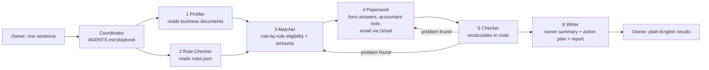

# Peluang 🇲🇾: find the government help your small business is missing

**Track 2: WorkBuddy Agentic Solutions · Dormathon 2026**

> A small-business owner types **one sentence**. A team of **six WorkBuddy agents** reads the business's own documents, checks them against an official-source rulebook of Malaysian **Budget 2026** help (grants, tax relief, financing), prepares the application answers and a note for the accountant, emails the owner for anything missing, checks its own numbers, and hands back a one-page plain-English summary.
>
> **It never submits anything.** The owner stays in control.

---

## The problem

Malaysian micro and small businesses are entitled to help every budget year: digitalisation grants, lower SME tax rates, tax deductions, stamp-duty exemptions and financing guarantees. In practice, owners miss them because:

- the rules are spread across BSN, LHDN, SJPP and Budget documents, often in Bahasa Malaysia legal wording;
- each scheme has its own conditions (ownership %, months operating, sales, sector, provider lists, deadlines);
- finding out "do I qualify, how much, and what do I need?" means hours of reading, or paying a consultant.

## What Peluang does

The owner (our demo owner is **Lina**, who runs Lina's Bakery Sdn. Bhd.) opens the Peluang workspace in WorkBuddy and types:

```
Check what government help my business is missing out on.
```

Peluang then delivers:

| Output | For whom | What it is |
|---|---|---|
| `<Business>_Summary.docx` | Owner | One page: "You could get about RM X", ✅/🟡/❌ per scheme, what to do this week, what we still need |
| `<Business>_Action_Plan.docx` | Owner | Tick-box checklist: this week / this month / later, with documents to bring |
| `Form_Answers` | Owner | Copy-ready answers for each application, taken from her own documents, with the "apply here" link, plus the upload checklist (unknowns marked **ASK OWNER**) |
| `Note_for_Accountant` | Accountant | Tax reliefs to claim in the yearly return, with figures and workings |
| Email to the owner | Owner | Only the open questions (e.g. "Have you received a digital grant before?"). Never asks for IC copies |
| `06-final-report.md`, `run-log.md`, JSON results | Reviewer / judge | Every rule check, calculation, source and agent call |

When the owner **replies to the email** (with answers and attachments), she types `I've replied to your email.` and the agents update everything.

## How it works: six WorkBuddy experts



| # | Expert | Job |
|---|---|---|
| 1 | **profiler** | Reads every document in the business folder (SSM profile, accounts, bank statements, payroll, quotes, bills, emails) and records each fact with its source file |
| 2 | **rule-checker** | Loads `rules.json` and the status of each measure (runs **in parallel** with the profiler) |
| 3 | **matcher** | Tests each condition (`field / operator / value`) against the facts; labels each measure (ready / needs something / automatic / optional / not eligible / coming soon); calculates amounts from the rulebook's own formulas |
| 4 | **paperwork** | Builds the application pack, form answers and accountant note; emails the owner only the open questions (Gmail connector) |
| 5 | **checker** | Independent quality check: **recalculates every number in code**, checks totals, deadlines, unconfirmed labels; sends work back to the responsible expert and re-checks |
| 6 | **writer** | Writes the owner's one-page summary and action plan in plain English, and the full technical report |

Design principles:

- **Rules live in data, not in the agents.** `rules.json` holds every condition with its source file, URL, `checked_on` date and `confidence` (official / unconfirmed). The agents are generic, so a new budget means updating the rulebook, not rewriting agents.
- **Every fact has a source.** Business facts cite the document they came from; rules cite the official page.
- **Safety:** never submits, never asks for IC/ID by email, tax figures are labelled "rough estimate, confirm with your accountant", third-party sources are labelled *unconfirmed*, never guesses a person's race or Bumiputera status.

## Where WorkBuddy is used

WorkBuddy is the **interface and the execution engine**:

- **Experts**: the six agents are WorkBuddy Experts (`experts/*.md`), launched as separate sub-agents ("Collaborative dispatch") by the coordinator.
- **Project instructions**: `AGENTS.md` is the coordinator playbook that turns the owner's one sentence into the multi-agent run.
- **Gmail connector**: the Paperwork expert emails the owner and reads her reply and attachments.
- **File tools + code**: reading PDFs/DOCX/XLSX, generating Word documents, recalculating numbers in Python.
- **Rulebook building**: WorkBuddy read the official sources in `rulebook-sources/` and produced and cross-checked `rules.json` (11 missing conditions found on re-check).

Screenshots are in [`docs/proof/`](docs/proof/).

## Results (demo business: Lina's Bakery, fictional)

See [`docs/evaluation.md`](docs/evaluation.md) for the full comparison against hand-checked answers. **Final one-sentence run: 7 of 8 schemes exactly right, 1 partly right (label only), 0 wrong, and all 6 planted traps caught.** Highlights:

- Digital grant **RM4,000** (50% of an RM8,000 quote), confirmed after the owner's email reply that she never had a previous digital grant
- SME tax rate saving **≈ RM8,415** a year (estimate)
- Hawker grant correctly **not eligible** (Sdn Bhd shop, not a street vendor)
- The **checker caught and fixed** wrong numbers itself: RM8,375 → **RM8,415**, and a guarantee fee of RM270 → **RM500** (the rulebook says *minimum RM500*)
- Stamp duty exemption counted only for the 2 **new** hires (contracts from 1 Jan 2026), not existing staff
- Urgent deadline flagged: the supplier's quote expires **18 Oct 2026**
- One sentence to finished, checked pack in **about 20 minutes**, unattended

## Try it yourself

You need the **WorkBuddy desktop app** (the web version can't read local folders).

1. **Download** this repository (Code → Download ZIP) and unzip it.
2. **Create the six experts:** in WorkBuddy go to *Experts · Skills · Connectors → My Experts → Create Expert*, and for each file in [`experts/`](experts/) create an expert with that name (`profiler`, `rule-checker`, `matcher`, `paperwork`, `checker`, `writer`) and paste the file's instructions.
3. **Connect Gmail** under *Connectors* (this is the account Peluang sends from).
4. **Open the folder as a workspace:** *New Task → Select Workspace →* the unzipped folder.
5. **Add your documents** to [`my-business/`](my-business/) (SSM profile, latest accounts or bank statements, payroll, quotes; see the README there). Or leave it empty to run the demo on `demo/lina-bakery/`.
6. Type: **`Check what government help my business is missing out on.`**
7. When you've answered the email, type: **`I've replied to your email.`**

Results appear in `outputs/run-<date>-<time>/`. An example of a full run is in [`demo/sample-output/`](demo/sample-output/).

## Repository map

```
peluang/
├── README.md            ← you are here
├── AGENTS.md            ← coordinator playbook: what WorkBuddy does when the owner asks
├── rules.json           ← the rulebook (every condition with its official source + confidence)
├── experts/             ← the six WorkBuddy experts (profiler, rule-checker, matcher, paperwork, checker, writer)
├── rulebook-sources/    ← official documents the rulebook was built from (BSN, LHDN, Budget 2026/2027)
├── my-business/         ← put YOUR business documents here
├── demo/
│   ├── lina-bakery/     ← fictional demo business (input documents)
│   └── sample-output/   ← what Peluang produced for it (summary, action plan, form answers, accountant note, agent log)
└── docs/
    ├── evaluation.md    ← accuracy vs hand-checked answers, self-corrections, time and cost
    └── proof/           ← screenshots of WorkBuddy building and running Peluang
```

## Limitations (honest list)

- The rulebook reflects sources checked on **10 Oct 2026**. Grant windows open and close (some are first-come-first-served), so always confirm on the official link before applying.
- Tax figures use profit before tax as a rough proxy for chargeable income: **estimates only**.
- Some measures (e-invoicing deduction, stamp duty, GGSM4) come from third-party summaries and are labelled *unconfirmed*.
- The demo business, its people, bank and supplier are fictional. The government schemes are real.

## Extending to Budget 2027

Budget 2027 was tabled on 9 Oct 2026. Its SME measures are already in `rules.json` as **"future – not yet in force"** and are never counted in totals. When details are published, add the new official documents to `rulebook-sources/` and ask WorkBuddy to re-check the rulebook. **The agents don't change.**

---
*Team **Solo Queue** (Lucas Lim, Taylor's University): built for Dormathon 2026, Track 2, with WorkBuddy as the primary build and execution engine.*
